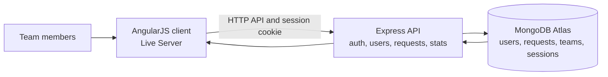
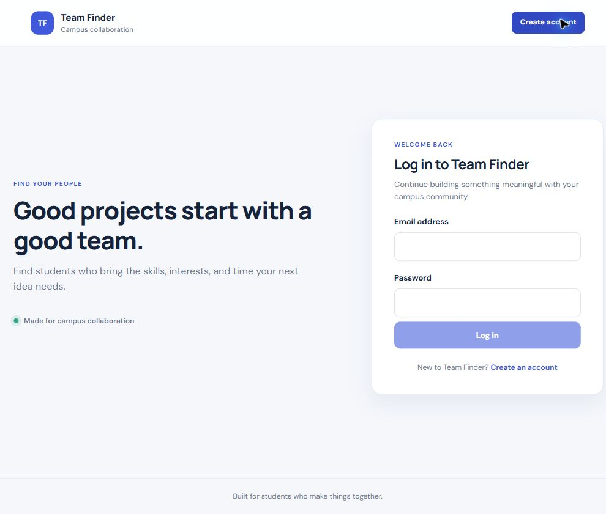
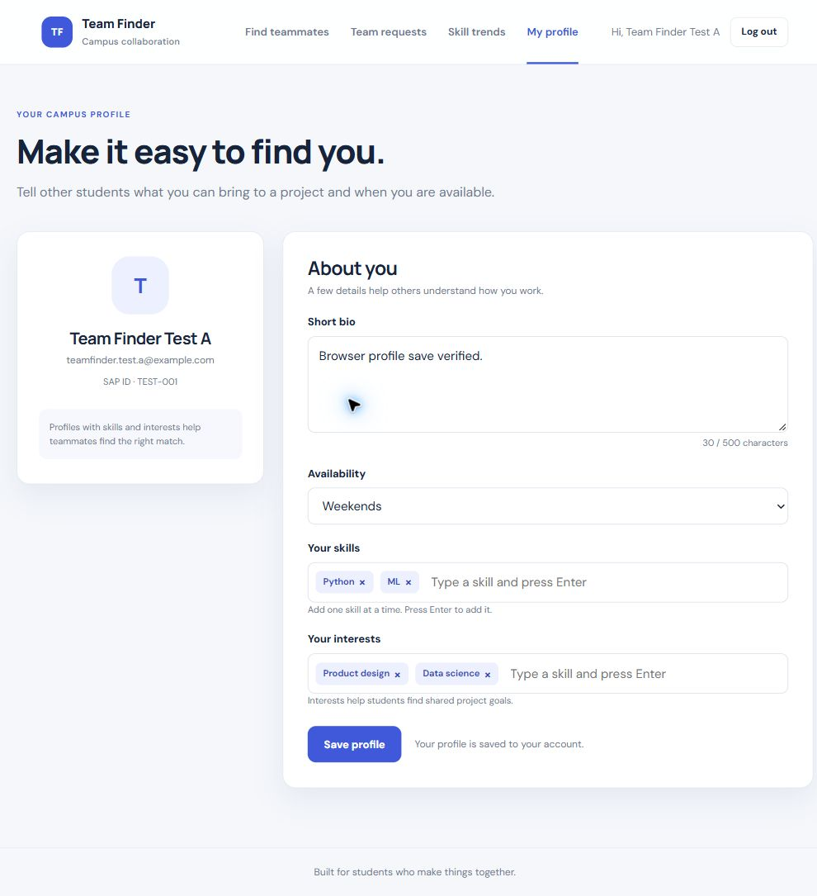
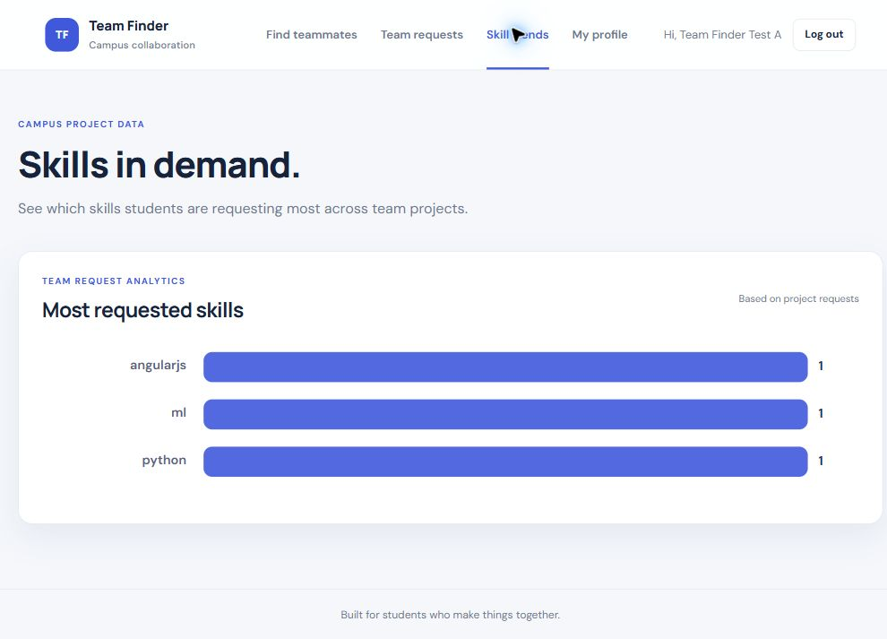

# Campus Skill-Based Project Team Finder

## Problem statement

Students often need teammates with the right skills for a project, but do not have a simple way to find and organize them. Team Finder provides a shared place to describe skills, find matching students, and manage project team applications.

## Objectives

- Let students create accounts and maintain a profile of their skills, interests, availability, and bio.
- Match students to peers using requested skills.
- Let students post team requests and manage applications.
- Show which skills are most requested in project postings.

## Team members and contributions

SAP IDs were not included with the names provided, so they are marked as not provided.

- **Bhavya** — SAP ID: Not provided — **Member A, Backend Lead (server, login, sessions).** Implemented the Express server setup, MongoDB connection, authentication routes, password hashing, and session authentication. Added server validation and error handling for the API.
- **Tanveer** — SAP ID: Not provided — **Member B, Database and Matching Logic Lead.** Implemented the user, team request, and team data models, plus profile and skill-search routes. Added skill normalization and matching scores for search results.
- **Ashish** — SAP ID: Not provided — **Member C, Frontend Core Lead (app setup, login, signup, profile).** Built the AngularJS app shell and routing, authentication screens, profile editor, and reusable skill-chip input. Connected these screens to the authenticated API.
- **Pratishtha** — SAP ID: Not provided — **Member D (search, requests, charts, testing, report).** Built the search, team-request, and trends pages, including the D3.js skill-demand chart. Verified the end-to-end request flow and prepared the report screenshots.

## Technology stack

- Frontend: AngularJS, HTML, CSS, and D3.js.
- Backend: Node.js and Express.
- Database: MongoDB Atlas with Mongoose.
- Authentication: bcryptjs password hashing and session cookies stored in MongoDB.

## Features

- Account signup, login, and logout.
- Editable student profiles with skills, interests, availability, and bio.
- Skill search with match percentages.
- Team request creation, application, and owner accept/reject actions.
- Team membership creation when an applicant is accepted.
- Skill-demand chart based on project requests.

## Architecture

## Database schema

- **User:** name, email, hashed password, SAP ID, bio, skills, interests, availability, and creation date.
- **TeamRequest:** project title, description, required skills, creator, open/closed status, applications and their statuses, and creation date.
- **Team:** name, project title, originating request, leader, accepted members, and creation date.
- **Session:** login session data stored in MongoDB for authenticated API requests.

## Verification performed

- Confirmed registration, login, session-protected profile access, profile updates, and logout.
- Confirmed skill search returns matching profiles and the trends page displays request skill counts.
- Confirmed request creation, application, owner acceptance/rejection, and stored team membership.
- Confirmed invalid input, duplicate accounts/applications, unauthorized access, and non-owner responses are rejected.

## Screenshots

### Login

### Signup

### Profile

### Skill search

### Team requests

### Skill trends

## Conclusion

Team Finder connects student skills with project needs through profiles, skill matching, team requests, and application management. The integrated application and its main user flows were verified against the project guide.
