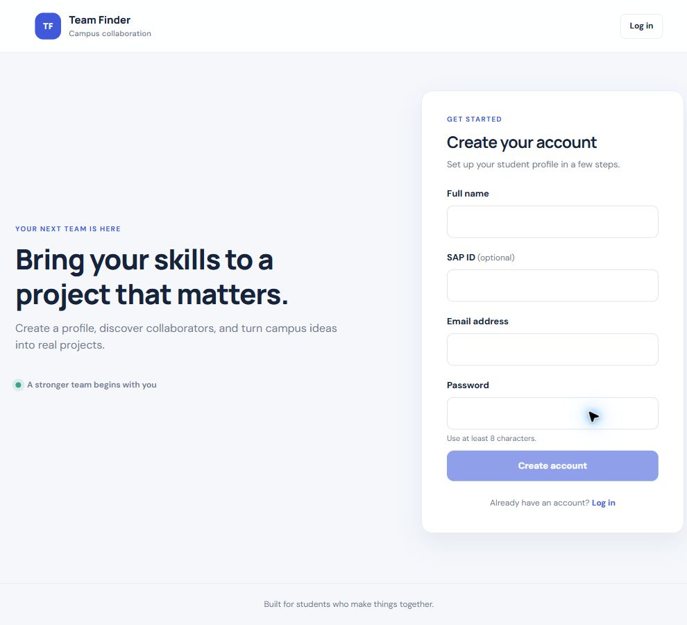
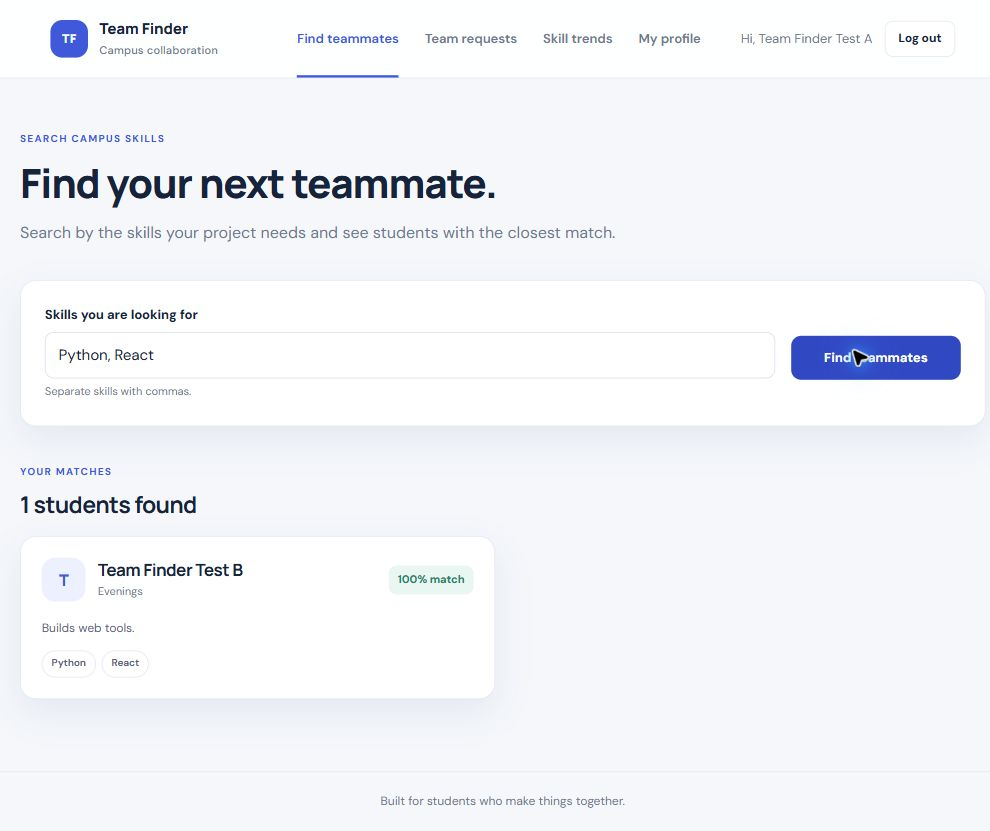
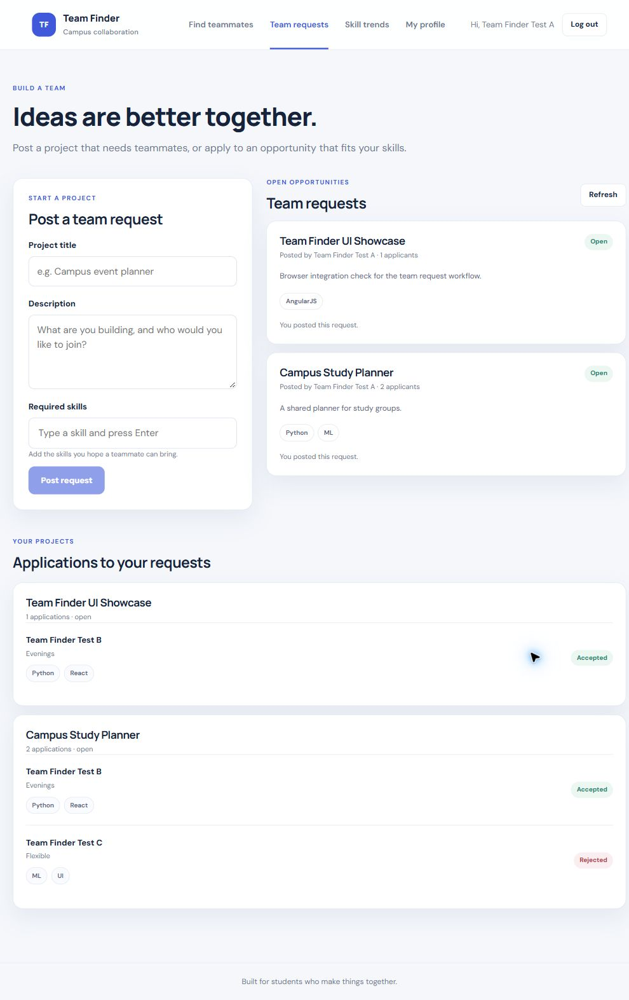

# Team Finder — Project Report

## Project overview

Team Finder helps students find teammates with complementary skills. Members can register, maintain a profile with skills and interests, search for matching members, publish a project request, apply to a request, and let the request owner accept or reject applicants. A trends page summarizes skill demand from project requests.

## Technology used

- Frontend: AngularJS, HTML, CSS, and D3.js.
- Backend: Node.js and Express.
- Database: MongoDB with Mongoose.
- Authentication: password hashing and session cookies stored in MongoDB.

## Application structure

```text
client/                         AngularJS frontend
  controllers/                  Login, profile, search, request, and trends flows
  directives/                   Skill chip display
  views/                        Login, signup, profile, search, requests, and trends
server/                         Express API
  middleware/                   Session authentication
  models/                       User, team request, and team schemas
  routes/                       Auth, user, request, and stats endpoints
docs/screenshots/               Captured application pages
```

## Main user flow

1. Register and log in.
2. Add a profile bio, skills, and interests.
3. Search members by skill and review match results.
4. Create a project request with required skills.
5. Other members apply; the owner accepts or rejects applications.
6. View skill demand on the trends page.

## Data models

- **User:** name, email, hashed password, bio, skills, interests, and timestamps.
- **TeamRequest:** creator, project title and description, required skills, application status, and timestamps.
- **Team:** request, leader, and accepted members.

## Team contributions

Replace the placeholders with the team's names before submission.

- Member A — [Name]: backend and database.
- Member B — [Name]: frontend pages and styling.
- Member C — [Name]: integration, verification, and report.
- Member D — [Name]: [contribution].

## Verification performed

- Confirmed registration, login, session-protected profile access, profile updates, and logout.
- Confirmed skill search returns matching profiles and the trends page displays request skill counts.
- Confirmed request creation, application, owner acceptance/rejection, and stored team membership.
- Confirmed invalid input, duplicate accounts/applications, unauthorized access, and non-owner responses are rejected.
- Captured the following pages from the running application.

## Screenshots

### Login


### Signup



### Profile


### Skill search



### Team requests



### Skill trends


